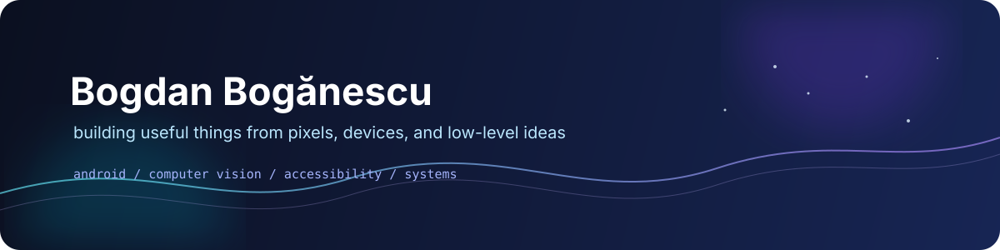

  

  <a href="https://github.com/Bogdan-06/VisionAssist">VisionAssist</a>
  ·
  <a href="https://github.com/Bogdan-06/nes-emu">NES Emulator</a>
  ·
  <a href="https://github.com/Bogdan-06/file-compressor">File Compressor</a>

## Hello

I’m Bogdan, a developer who likes turning technical ideas into things that can actually be used.

I build across Android, computer vision, voice interfaces, desktop tools, and emulation. I’m especially interested in the space where software meets people: clear interfaces, accessible interaction, and systems that behave predictably.

I also enjoy going in the other direction—from a camera frame or a UI interaction down to memory maps, instruction sets, and runtime behavior.

## What I’m building

### [VisionAssist](https://github.com/Bogdan-06/VisionAssist)

An Android assistive prototype with offline object recognition, Romanian voice assistance, and an accessible Jetpack Compose interface.

| | |
| :--- | :--- |
| **On-device** | CameraX, MediaPipe, and a bundled model |
| **Accessible** | TalkBack-readable results, large controls, Romanian text-to-speech |
| **Connected when needed** | Optional Gemini Live and OpenAI Realtime integrations |

> Experimental software: object recognition is not a validated hazard detector or navigation system.

## Things I like building

<table>
  <tr>
    <td width="50%" valign="top">
      <h3>Interfaces that help</h3>
      
Accessible Android experiences, voice feedback, camera tools, and controls that stay understandable.

      <code>Kotlin</code> <code>Compose</code> <code>CameraX</code>
    </td>
    <td width="50%" valign="top">
      <h3>Systems worth understanding</h3>
      
Emulators and experiments that make hardware, memory, and instruction execution less mysterious.

      <code>C++</code> <code>SDL2</code> <code>CMake</code>
    </td>
  </tr>
  <tr>
    <td width="50%" valign="top">
      <h3>Practical desktop tools</h3>
      
Small utilities that solve real problems, from media compression to gesture-based controls.

      <code>C#</code> <code>.NET</code> <code>Python</code>
    </td>
    <td width="50%" valign="top">
      <h3>Experiments with a purpose</h3>
      
I use prototypes to test ideas, learn unfamiliar systems, and turn rough concepts into working software.

      <code>MediaPipe</code> <code>FFmpeg</code> <code>Firebase</code>
    </td>
  </tr>
</table>

## Selected work

| Project | Why it is interesting |
| :--- | :--- |
| [File Compressor](https://github.com/Bogdan-06/file-compressor) | A Windows tool for queued media/file compression and side-by-side previews |
| [FriendMap](https://github.com/Bogdan-06/friendmap) | Opt-in live location sharing, maps, friend requests, and notifications |
| [Hand Gesture Media Control](https://github.com/Bogdan-06/hand-gesture-media-control) | Configurable webcam gestures for media playback and volume control |
| [NES Emulator](https://github.com/Bogdan-06/nes-emu) | A C++17 exploration of console architecture |
| [PS1 Emulator](https://github.com/Bogdan-06/ps1-emulator) | BIOS loading, memory mapping, and a MIPS R3000A interpreter |

## Current toolkit

`Kotlin` `Android` `Jetpack Compose` `CameraX` `MediaPipe` `C++` `C#` `Python` `CMake` `SDL2` `FFmpeg` `Node.js` `Firebase`

Most repositories are experiments or active prototypes. Each project README is the source of truth for its current status, setup instructions, and limitations.
