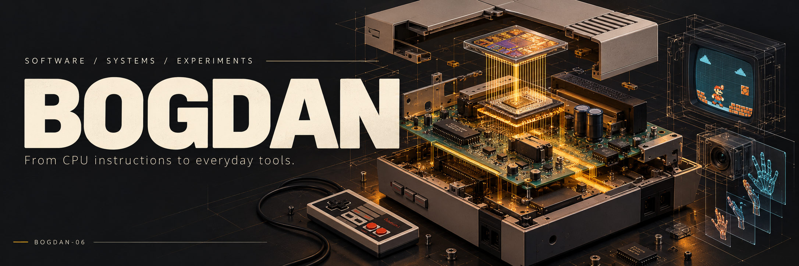
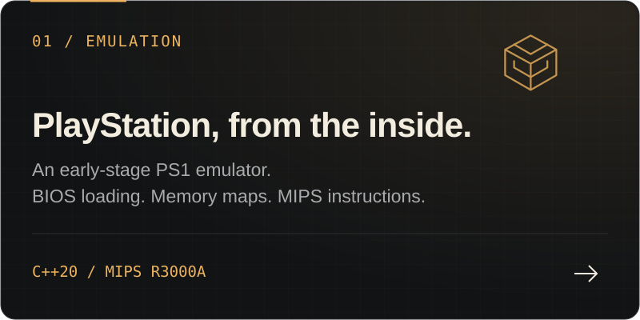
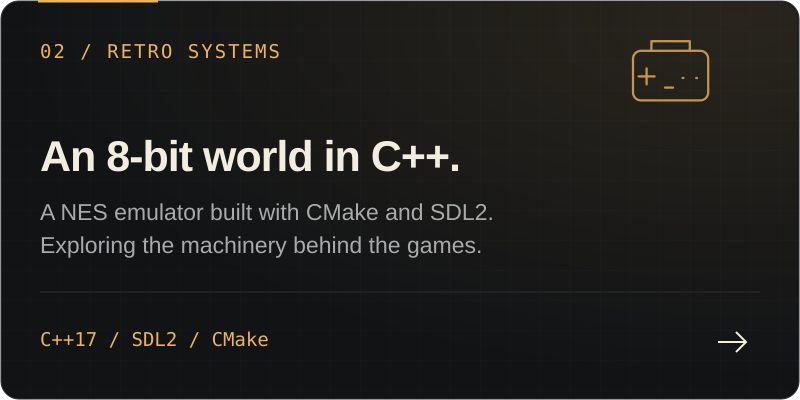
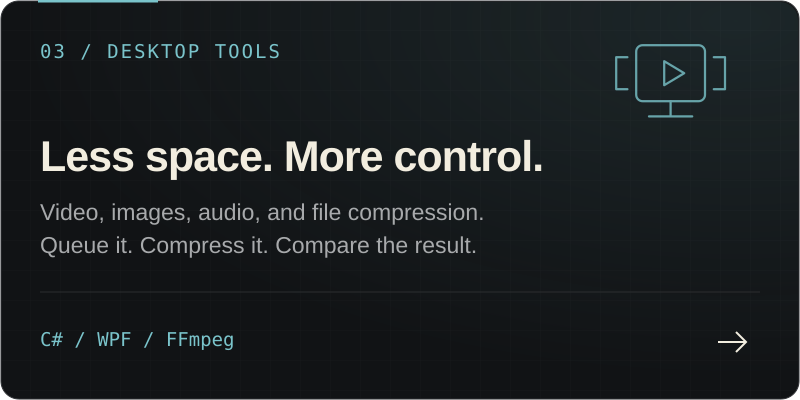
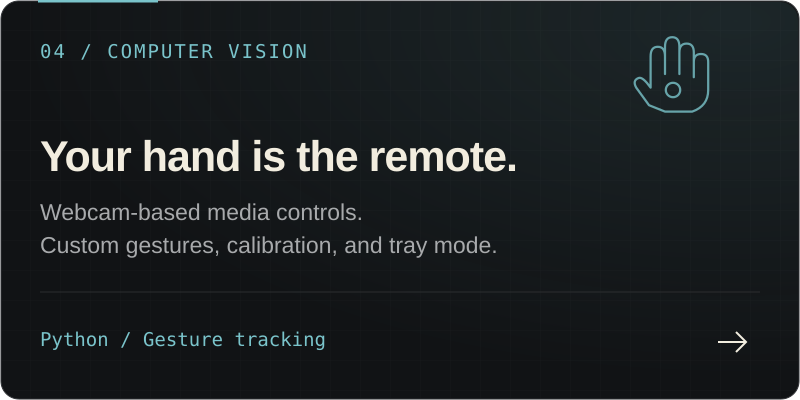

  

  <strong>I build emulators, useful apps, and experiments in how we interact with software.</strong> 
  From figuring out what a CPU instruction does to making an everyday tool feel better to use.

 

### Selected work

  
  

  
  

**Also on mobile → [FriendMap](https://github.com/Bogdan-06/friendmap)**  
An Android app with friend requests, optional live location sharing, Google Maps, and Firebase notifications.

 

### In the toolbox

  
  
  
  
  
  

`SDL2` · `CMake` · `WPF` · `FFmpeg` · `Google Maps`

 

---

<strong>BOGDAN-06</strong> &nbsp; / &nbsp; From CPU instructions to everyday tools.

